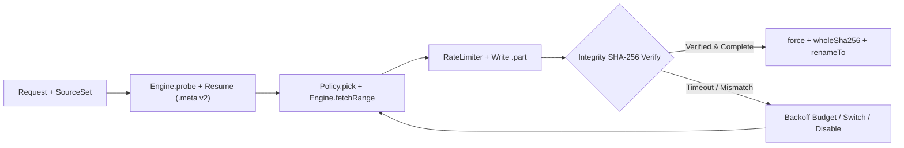

<h1 align="center">Anabranch Core</h1>

<p align="center">
  
  
  
</p>

<p align="center">
  <a href="README.md">简体中文</a> · <strong>English</strong> · <a href="https://anabranch-core.cbnv.me/en/">Documentation Site</a> · <a href="LICENSE">AGPL-3.0-only</a>
</p>

Zero-dependency multi-source segmented download library for **Java 8 and Android (`minSdk 21`)**: splits one file into byte ranges across mirrors with throughput-aware selection, per-chunk failover, cross-source resume, and SHA-256 verification, paired with an optional standalone `aria2` JNI backend (`anabranch-aria2`).

## Core Capabilities & Flow

- **Multi-Mirror Chunk Scheduling**: Dispatches byte intervals across identical mirrors via `SourceSet` using `Policy.fastestFirst()` (EMA throughput vs. in-flight concurrency) or `Policy.weighted()`.
- **Bounded Failover & Circuit Breaking**: Caps retries at 6 attempts per chunk and 2000ms exponential backoff; `chunkRetryBudgetMs` (default `60_000` ms) counts only failures rather than healthy slow transfers, disabling a source for the current download after 3 consecutive errors.
- **Resumable `.meta` v2 & Digest Guard**: Persists `P/D/V` chunk states across `<target>.part` and `anabranch-meta/2` (`.meta`), validates `ETag` on same-source resumes, and checks per-chunk and whole-file SHA-256 digests before target rename.
- **Java 8 & Artifact Isolation**: Core comprises 19 plain Java 8 files with zero third-party deps and zero `android.*` imports; optional `aria2` native binaries ship in a separate AAR.

## Capabilities & Explicit Non-Goals

| Area | What Anabranch Core Delivers | Explicit Non-Goals & Hard Bounds |
| --- | --- | --- |
| Scheduler & Resume | Zero-dep Java 8 (19 files, `minSdk 21` clean), multi-mirror chunking, `fastestFirst()`, `.part` + `.meta` resume, SHA-256 checks | **No** built-in mirror URLs, global persisted config, archive extraction, APK install, UI, or foreground services; `Source.maxChunks` is metadata-only today |
| Extensions & `aria2` | Pluggable `Engine` / `Policy` / `Source.Resolver`; `anabranch-aria2` AAR isolates `GPL-3.0-or-later` obligations | `Aria2Downloader` serializes globally under `BUSY` and bypasses Core `Policy`; Maven Central publication is manual (verify live coordinates) |



## Quick Start & Integration Modes

Daily verification needs only a JDK supporting `--release 8` and Python 3 (no Gradle wrapper bundled); the shortest local test & Java call path is:

```sh
git clone https://github.com/CyberNova2333/anabranch-core.git
cd anabranch-core
sh tools/run-checks.sh          # Java 8 compile + boundary guard + loopback HTTP suites
# sh aria2/native/run-host-tests.sh   # Optional: build host libaria2 .so & run 28 download tests
```

Minimal Java call (`dl.probeAll(key, set, cancel)` can preflight mirror agreement first):

```java
Downloader dl = Downloader.newBuilder().defaultChunks(8).maxConcurrent(4).build();
SourceSet set = new SourceSet(Arrays.asList(
    Source.ofBase("cdn-a", "https://cdn-a.example.test/files/"),
    Source.ofBase("cdn-b", "https://cdn-b.example.test/files/")),
    Policy.fastestFirst());
Result res = dl.download(Request.of("pkg.bin", new File("out/pkg.bin")), set, Listener.NONE, Cancellation.NONE);
```

| Mode / Platform | Scope & Preconditions | Documentation Link |
| --- | --- | --- |
| **Pure Java 8 / JVM Core** | Zero deps, default `HttpEngine`; Maven coordinate `io.github.cybernova2333:anabranch-core:0.1.0` | [Overview & Quick Start](docs-site/en/docs/index.md) |
| **Android (`minSdk 21`)** | Verified via `javac --release 8` and boundary scans; no desugaring required; needs `INTERNET` | [Integration & Troubleshooting](docs-site/en/docs/deployment.md) |
| **Optional `aria2` JNI Backend** | Separate `anabranch-aria2` AAR with single-thread `runOnce` and TLS dead-man's switch | [aria2 Design](docs/ARIA2.md) · [Build & Setup](docs-site/en/docs/deployment.md) |
| **Custom `Engine` / `Policy`** | Plug in OkHttp or custom selection rules while preserving unidirectional core boundaries | [API & Extension Contracts](docs-site/en/docs/contracts.md) · [API & Component Reference](docs-site/en/api-reference/index.md) |

## Pre-Adoption FAQ

**1. Why choose Anabranch Core over Android `DownloadManager` or single-URL chunked libraries?**
Typical libraries open parallel connections to one URL; Anabranch Core orchestrates one logical file across multiple mirrors with adaptive speed scoring, per-chunk failover, and SHA-256 verification.

**2. Does Android `minSdk 21` require core library desugaring?**
No. Both `src/io/anabranch/` and `aria2/` Java layers compile strictly with `javac --release 8` and forbid API 24+/26+ runtime classes and `android.*` imports.

**3. Is `io.github.cybernova2333:anabranch-core:0.1.0` already live on Maven Central?**
Coordinates, GPG signing hooks, and `centralBundle` packaging live in `build.gradle.kts`, while publishing is a manual step documented in `docs/RELEASING.md`; confirm Central availability or build from `src/`.

**4. Why is the optional `aria2` backend packaged separately from `anabranch-core`?**
Upstream `libaria2` is GPLv2+, imposing `GPL-3.0-or-later` source-distribution obligations on compiled AARs; isolating `aria2/` keeps `anabranch-core` zero-weight and strictly `Apache-2.0`.

## Reading Paths

| Goal | Documentation Site | Repository Reference |
| --- | --- | --- |
| Evaluate & integrate quickly | [Getting Started & Deployment](docs-site/en/docs/index.md) | [Configuration & Troubleshooting](docs-site/en/docs/deployment.md) |
| Extend `Engine`, `Policy`, or `Resolver` | [API & Extension Contracts](docs-site/en/docs/contracts.md) | [Scheduling, Resume & Integrity](docs-site/en/docs/mechanisms.md) |
| Trace source code & locate files | [Architecture & Source Guide](docs-site/en/docs/architecture.md) | [Source Guide (`repo-docs`)](repo-docs/README.md) · [Code Map](docs-site/en/docs/code-map.md) |
| Inspect design history & releasing | [Design Decisions & Releasing](docs-site/en/docs/decisions.md) | [Maven Central Release Guide](docs/RELEASING.md) · [Contributing](CONTRIBUTING.md) |

## License & Scope Boundary

- **Licensing**: `anabranch-core` and Java glue under `aria2/src/` use [AGPL-3.0-only](LICENSE); compiled `anabranch-aria2` binary AAR distributions are licensed under **GPL-3.0-or-later** per [`aria2/THIRD-PARTY-NOTICES.md`](aria2/THIRD-PARTY-NOTICES.md).
- **Stateless boundary**: Designed clean-room without hard-coded URLs, persisted preferences, archive extraction/APK installation, or UI/foreground services; mirror equivalence is backed by caller-supplied `Integrity` digests.
