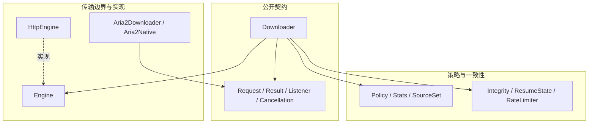

# Anabranch · 多源分块下载 🌊

> **面向 Java 与 Android 的多源下载库：分块调度、续传、校验与可替换引擎。**

[English](README.en.md) · [架构设计](docs/DESIGN.md) · [Apache-2.0](LICENSE)

同一个文件可以从多条线路按块获取；调度器依据实测吞吐分配任务，失败时重试或换源，校验通过后再提交成品。核心采用 Java 8 字节码、零第三方依赖，不引用 Android API；Android 兼容目标为 minSdk 21。

<a id="-架构与职责"></a>

**阅读导航**

[🏛️ 分层代码架构](#section-1) · [🚀 快速开始](#section-2) · [⚙️ 使用边界](#section-3) · [🧪 验证与协作](#section-4) · [📜 许可](#section-5) · [⚙️ 集成与产物](#section-6)

---

<a id="section-1"></a>


> 📐 **交互式架构图表**：支持动态探查、缩放平移与主题切换的高保真架构图：[多端镜像同步引擎架构图](https://cybernova2333.github.io/anabranch-core/diagrams/anabranch-architecture.html)。

## 🏛️ 分层代码架构

核心库通过 `Engine` 隔离网络取字节能力，`Downloader` 负责调度和文件提交。`aria2/` 是共享请求类型的独立后端，当前并不实现 `Engine`，也没有打进 core JAR；核心不反向依赖它或 Android。

图中展示主要代码依赖：实线箭头指向被调用或被依赖的模块，虚线表示实现或生成关系；数据读写另用连线文字标明。



| 层次 | 源码入口 | 职责与边界 |
|---|---|---|
| 公开契约 | [Request / Result / Listener / Cancellation](src/io/anabranch/Request.java) | 描述任务、结果、进度与取消。 |
| 公开契约 | [Downloader](src/io/anabranch/Downloader.java) | 组织探测、分块并发、重试、续传与最终提交。 |
| 策略与一致性 | [Policy / Stats / SourceSet](src/io/anabranch/Policy.java) | 维护源状态和选路依据。 |
| 策略与一致性 | [Integrity / ResumeState / RateLimiter](src/io/anabranch/Integrity.java) | 摘要与块校验、续传记录、限速。 |
| 传输边界与实现 | [Engine](src/io/anabranch/Engine.java) | 定义探测与指定字节区间写入接口。 |
| 传输边界与实现 | [HttpEngine](src/io/anabranch/HttpEngine.java) | 默认 HTTP 传输实现。 |
| 传输边界与实现 | [Aria2Downloader / Aria2Native](aria2/src/io/anabranch/aria2/Aria2Downloader.java) | 独立下载实现，通过 JNI 调用 native 后端。 |

<a id="-快速开始"></a>

<a id="section-2"></a>

## 🚀 快速开始

准备 JDK 17 或 21（与当前 CI 一致）、Python 3、Git 和 POSIX shell，在仓库根目录运行；core 编译仍以 `javac --release 8` 检查兼容性：

```sh
sh tools/run-checks.sh
```

脚本执行 Java 8 兼容编译、完整编译、core 边界检查和测试。下载测试使用本地 HTTP 服务传输真实字节；无需访问业务线路。

Maven Central **尚未发布**。预定坐标与发布步骤见 [发布说明](docs/RELEASING.md)，集成时先按 [设计文档](docs/DESIGN.md) 使用源码。

<a id="-使用边界"></a>

<a id="section-3"></a>

## ⚙️ 使用边界

- 同源续传比较 ETag；跨源以长度及内容摘要确认，不能用不同服务器的 ETag 判断是否为同一文件。
- 限速针对整次下载；策略层负责重试、切源和失败预算，引擎只负责取字节。
- 服务端不支持 Range 时退化为整份下载，中断后无法续传。
- aria2 后端的真机验证与独立 AAR 发布仍待完成，见 [aria2 接入说明](docs/ARIA2.md)。

<a id="-验证与协作"></a>

<a id="section-4"></a>

## 🧪 验证与协作

修改 native 后端时另运行 `sh aria2/native/run-host-tests.sh`，环境要求见其脚本与 aria2 文档。
贡献规则见 [CONTRIBUTING.md](CONTRIBUTING.md)、[AGENTS.md](AGENTS.md) 和 [CLAUDE.md](CLAUDE.md)。

<a id="-许可"></a>

<a id="section-5"></a>

## 📜 许可

core 使用 [Apache-2.0](LICENSE)。aria2 后端单独分发，其依赖许可与源码提供要求见 [aria2 文档](docs/ARIA2.md)。

<a id="section-6"></a>

## ⚙️ 集成与产物

[build.gradle.kts](build.gradle.kts) 定义 core 的 Java 库与发布元数据，[settings.gradle.kts](settings.gradle.kts) 定义工程名称。仓库没有 Gradle wrapper，需自行准备兼容 Gradle；首次验证优先使用上面的 `run-checks.sh`，它直接调用 JDK，无需先发布制品。

调用方提供下载请求、源列表和目标文件；先参考 [设计文档](docs/DESIGN.md) 与 [测试目录](test/) 的实际调用。下载成功、可恢复的中间文件和校验失败是不同结果，集成层不应在校验前把临时文件当作成品。

<!-- repo-docs routing -->

## 源码指南与文档站

把同一个文件拆为可调度的块，从多条源取字节；失败重试、续传与可选摘要校验都在提交成品前完成。核心是独立 Java 库，Android 接线和 native 后端有各自边界。

从[阅读路径](repo-docs/README.md)进入[一条真实主流程](repo-docs/walkthroughs/one-real-run.md)，再用[代码地图](repo-docs/code-map.md)定位改动。证据与未覆盖边界见[源码调查记录](repo-docs/references/source-evidence.md)。

## 文档站

文档站采用 VitePress 默认主题，依赖与业务项目分开安装。默认输出 `docs-site/.vitepress/dist/`；独立核验可在构建命令后加 `-- --outDir <仓库外绝对目录>`。指南正文只维护 `repo-docs/`，站点通过 include 读取；网页中的仓库源码链接显示为精确文件路径，不复制源码或本机资源。

```sh
npm --prefix docs-site ci
npm --prefix docs-site run docs:dev -- --host 127.0.0.1
npm --prefix docs-site run docs:build
```
