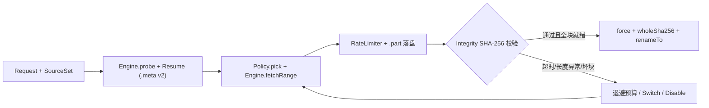

<h1 align="center">Anabranch Core</h1>

<p align="center">
  
  
  
</p>

<p align="center">
  <strong>简体中文</strong> | <a href="README.en.md">English</a>
</p>

<p align="center">
  <a href="https://anabranch-core.cbnv.me/">在线文档站</a> · <a href="LICENSE">AGPL-3.0-only</a>
</p>

面向 **Java 8 与 Android (`minSdk 21`)** 的零第三方依赖多源分块下载库：将单个文件拆分为固定字节区间派发至多条同构镜像，提供吞吐测速选源、分块失败切源、跨源断点续传与 SHA-256 逐块/整份校验，另有独立封装的可选 `aria2` JNI 原生后端（`anabranch-aria2`）。

## 核心能力与下载流程

- **多源并发分块调度**：通过 `SourceSet` 绑定 `Policy.fastestFirst()`（基于 EMA 实时吞吐与在途并发数评分）或 `Policy.weighted()`（原子加权轮询），将单文件并行分片到多条镜像。
- **失败切源与预算熔断**：单块上限 6 次尝试与 2000ms 指数退避，`chunkRetryBudgetMs`（默认 `60_000` ms）仅计入失败重试开销而不惩罚健康慢传；单源连续失败满 3 次即在本轮下载禁用。
- **跨源续传与可信校验**：伴生 `<target>.part` 与 `anabranch-meta/2` 控制文件记录 `P/D/V` 块状态；同源对比 `ETag`，跨源续传依赖调用方通过 `Integrity` 提供的逐块与整份 SHA-256。
- **纯 Java 8 边界与产物隔离**：`src/io/anabranch/` 全部 19 个核心文件零 `android.*`、零三方依赖且通过 `javac --release 8` 校验；`aria2` 原生后端独立成 AAR，互不牵连。

## 能做到什么程度与明确不能做什么

| 维度 | 能做到什么程度（已实现能力） | 明确不能做什么（非目标与硬限制） |
| --- | --- | --- |
| 核心调度与续传 | 纯 Java 8（19 源文件，`minSdk 21` 免 desugaring）多镜像分块、`Policy.fastestFirst()`、`.part` + `.meta` 续传与 SHA-256 核验 | **不内置**镜像清单/持久化配置/解压与安装/UI 与前台服务；`Source.maxChunks` 目前仅为元数据字段 |
| 扩展与 `aria2` 隔离 | 支持自定义 `Engine`（如 OkHttp）、`Policy` 与 `Source.Resolver`；`anabranch-aria2` AAR 隔离 `GPL-3.0-or-later` | `Aria2Downloader` 全局 `BUSY` 串行且忽略 Core `Policy`；Maven Central 坐标须手动触发发布，集成前需核实在线状态 |



## 快速开始与多场景入口

仓库日常编测不依赖 Gradle Wrapper，直接使用支持 `--release 8` 的 JDK 与 Python 3 即可编译核心与原生胶水层并跑通本地真实 HTTP 集成测试；Java 代码调用最短路径如下：

```sh
git clone https://github.com/CyberNova2333/anabranch-core.git
cd anabranch-core
sh tools/run-checks.sh          # core/aria2 Java 8 编译 + 边界扫描 + 真实 HTTP 回归
# sh aria2/native/run-host-tests.sh   # 可选：宿主环境构建 libaria2 .so 并跑 28 项下载测试
```

Java 最小调用形式（如需提前比对镜像版本一致，可先调 `dl.probeAll(key, set, cancel)`）：

```java
Downloader dl = Downloader.newBuilder().defaultChunks(8).maxConcurrent(4).build();
SourceSet set = new SourceSet(Arrays.asList(
    Source.ofBase("cdn-a", "https://cdn-a.example.test/files/"),
    Source.ofBase("cdn-b", "https://cdn-b.example.test/files/")),
    Policy.fastestFirst());
Result res = dl.download(Request.of("pkg.bin", new File("out/pkg.bin")), set, Listener.NONE, Cancellation.NONE);
```

| 接入模式 / 目标平台 | 定位与前置约束 | 详细说明入口 |
| --- | --- | --- |
| **纯 Java 8 / JVM 核心库** | 零第三方依赖，`HttpEngine` 开箱即用；预定 Maven 坐标 `io.github.cybernova2333:anabranch-core:0.1.0` | [起步与双产物概览](docs-site/docs/index.md) |
| **Android (`minSdk 21`) 接入** | 通过 `--release 8` 与边界扫描，无需开启 Core Library Desugaring；需 `INTERNET` 权限 | [集成配置、权限与排错](docs-site/docs/deployment.md) |
| **可选 `aria2` JNI 后端** | 独立 `anabranch-aria2` AAR；libaria2 单线程 `runOnce` 驱动 + 双 TLS 后端 dead-man's switch | [aria2 设计说明](docs/ARIA2.md) · [原生构建](docs-site/docs/deployment.md) |
| **自定义 `Engine` / `Policy`** | 支持替换 OkHttp 等传输栈或实现自定义选路/熔断策略，严守向内单向依赖边界 | [公开 API 与扩展契约](docs-site/docs/contracts.md) · [API 与组件参考](docs-site/api-reference/index.md) |

## 选型前常见问题

**1. 相比系统 `DownloadManager` 或常见单源分块库，为什么用 Anabranch Core？**
常见下载库只针对单个 URL 开多线程；Anabranch Core 围绕「同一份文件、多条 CDN/镜像并发调度」设计，原生支持测速让渡、坏块拦截重下与故障切源。

**2. Android `minSdk 21` 集成是否需要开启 Core Library Desugaring？**
不需要。`src/io/anabranch/` 与 `aria2/` 的 Java 层均通过 `javac --release 8` 与静态边界扫描，避免引入 API 24+/26+ 才提供的标准库与 `android.*` 类库。

**3. `io.github.cybernova2333:anabranch-core:0.1.0` 已经在 Maven Central 上线了吗？**
坐标、GPG 签名任务与 `centralBundle` 打包逻辑已完备写入 `build.gradle.kts`，但发版是手动触发动作；集成前请核实 Central 在线状态或直接引用 `src/` 源码。

**4. 为什么不把 `aria2` 直接合进 `anabranch-core`？**
上游 `libaria2` 采用 GPLv2+，静态打包 `.so` 的 AAR 须按 `GPL-3.0-or-later` 分发并履行对应源码义务；隔离成独立模块让纯 Java 用户零体积负担且无许可传染风险。

## 文档阅读路径

| 读者目标 | 文档站入口 | 仓库直链参考 |
| --- | --- | --- |
| 了解双产物定位与快速接入 | [起步与集成部署](docs-site/docs/index.md) | [配置参数与原生构建](docs-site/docs/deployment.md) |
| 扩展 `Engine`、`Policy` 与了解差异 | [公开 API 与扩展契约](docs-site/docs/contracts.md) | [调度、`.meta` v2 续传与校验](docs-site/docs/mechanisms.md) |
| 走读源码与定位修改文件 | [架构全景与一次真实运行](docs-site/docs/architecture.md) | [源码指南 (`repo-docs`)](repo-docs/README.md) · [代码地图](repo-docs/code-map.md) |
| 审计设计演化与发版手续 | [设计决策、演进与发布迁移](docs-site/docs/decisions.md) | [Maven Central 发布手册](docs/RELEASING.md) · [贡献指南](CONTRIBUTING.md) |

## 许可与独立边界

- **开源协议**：`anabranch-core` 核心库及 `aria2/` 纯 Java 胶水源码均以 [AGPL-3.0-only](LICENSE) 发布；包含编译产物 `.so` 的可选 `anabranch-aria2` 二进制 AAR 整体遵循 **GPL-3.0-or-later**，第三方许可清单与源码义务见 [`aria2/THIRD-PARTY-NOTICES.md`](aria2/THIRD-PARTY-NOTICES.md)。
- **无状态库边界**：本库采用净室设计并保持完全无状态——不内置镜像 URL 清单、不持久化全局配置、不承担压缩包解压或 APK 安装、不构建 UI 或前台服务；镜像一致性由调用方及所提供的 `Integrity` 摘要共同保证。

- **附加条款与资产规则**：本项目依据 GNU AGPLv3 第 7 条适用 [`LICENSE-ADDITIONAL_TERMS-zh-CN.md`](LICENSE-ADDITIONAL_TERMS-zh-CN.md)（英文参考译文：[`LICENSE-ADDITIONAL_TERMS-en.md`](LICENSE-ADDITIONAL_TERMS-en.md)，以简体中文完整版正文为准），对来源陈述、修改标识、禁止冒充、扩展模块有条件附加许可及项目标识边界作出补充说明；独立美术、字体与图标许可清单见 [`ASSET_LICENSES.md`](ASSET_LICENSES.md)。第 9.5–9.6 款的附加许可豁免仅对已取得相应版权持有人有效授权的适用材料生效，未取得该等授权的第三方或上游材料仍受其原有有效许可约束。
